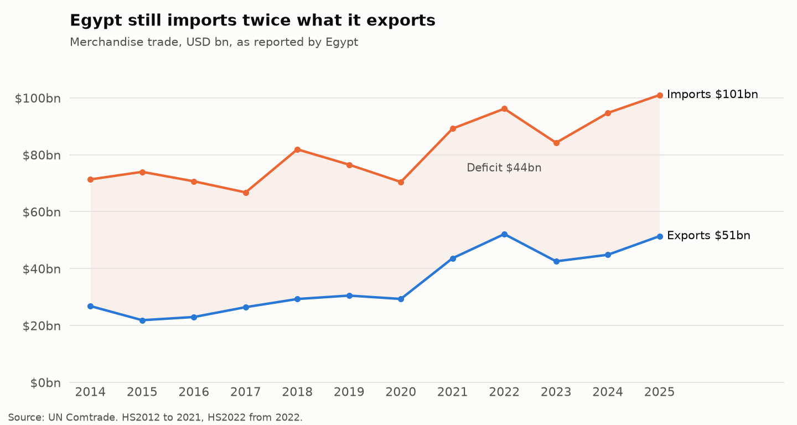
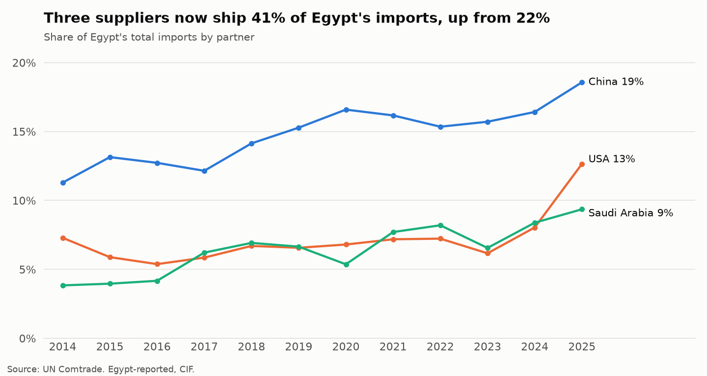
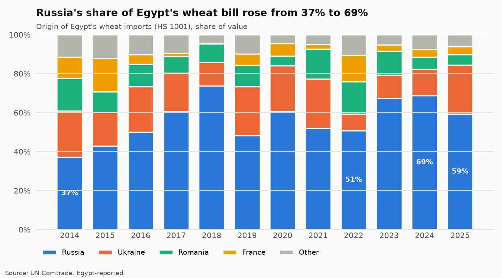
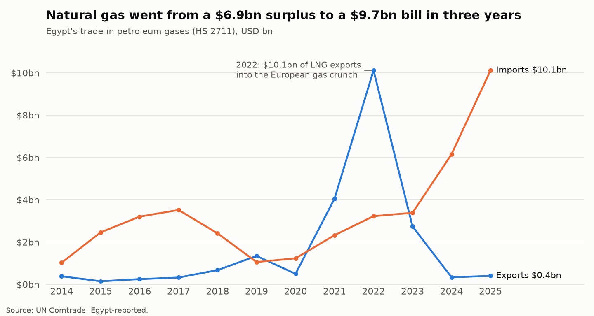
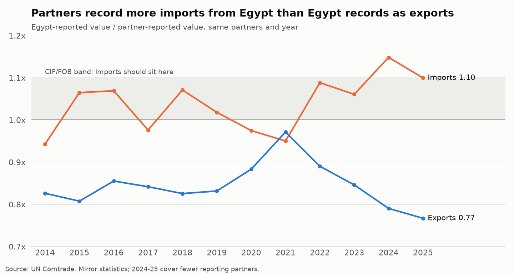

# Egypt's Trade 2014–2025 (UN Comtrade)

**Twelve years of Egypt's customs-reported merchandise trade, pulled from the UN Comtrade API into a bronze → silver → gold DuckDB warehouse, to answer: what does Egypt buy and sell, from whom, how exposed is it, and do its customs records agree with its partners'?**

[](https://www.python.org/)
[](https://duckdb.org/)
[](https://comtradeplus.un.org/)



<p align="center"><b><a href="https://4maxr.github.io/egypt-trade-comtrade/dashboard.html">Open the interactive dashboard &rarr;</a></b><br>
<sub>Self-contained HTML · hover for exact values · imports/exports toggles · data tables · light &amp; dark</sub></p>

---

## Navigation

- [Key Insights](#key-insights)
- [Questions & Findings](#questions--findings)
- [Pipeline](#pipeline)
- [Data Model](#data-model)
- [Data Quality & Limitations](#data-quality--limitations)
- [Setup & Reproduction](#setup--reproduction)
- [Project Structure](#project-structure)

---

## Key Insights

| # | Insight | Evidence |
|---|---------|----------|
| 1 | **The deficit has not shrunk.** Exports almost doubled ($26.8bn → $51.4bn), but imports reached a record $101bn, so the gap is still ~$50bn a year. | Q1 |
| 2 | **Import dependence is concentrating.** China, the USA and Saudi Arabia went from 22% to 41% of imports. The partner HHI rose from 441 to 747, and the top five suppliers now take 51%. | Q2–Q3 |
| 3 | **Gas flipped from earner to cost.** Petroleum gases went from a +$6.9bn surplus (2022) to a −$9.7bn deficit (2025), a $16.6bn swing in three years. | Q6 |
| 4 | **Wheat runs through Russia.** Russia's share of the wheat bill rose from 37% to 69% in 2024. Ukraine fell to 9% in 2022 and recovered to 25% in 2025. | Q5 |
| 5 | **The export mix shifted toward gold.** HS 71 (precious metals and stones) grew from 2.5% to 14.8% of exports ($0.7bn → $7.6bn). The UAE became the top export market (3.7% → 13.7%). | Q4, Q2 |
| 6 | **Egypt's export records run consistently below its partners' import records.** Partners record 3–30% more imports from Egypt than Egypt records as exports, and the gap widened after 2022. | Q7 |

---

## Questions & Findings

Every number below comes from a query in [`sql/analysis/`](sql/analysis). The full result tables are written to `outputs/tables/` by `scripts/run_analysis.py`.

### Q1. How did the trade balance move? — [`01_trade_balance.sql`](sql/analysis/01_trade_balance.sql)

| Year | Imports | Exports | Balance | Exports / imports |
|------|--------:|--------:|--------:|------------------:|
| 2014 | $71.3bn | $26.8bn | −$44.5bn | 38% |
| 2017 | $66.8bn | $26.4bn | −$40.3bn | 40% |
| 2022 | $96.2bn | $52.1bn | −$44.1bn | 54% |
| 2023 | $84.2bn | $42.6bn | −$41.7bn | 51% |
| 2025 | $101.0bn | $51.4bn | −$49.6bn | 51% |

Both devaluation episodes show up in imports. They fell 5.5% in 2017, after the November 2016 float, and 12.4% in 2023, during the 2022–23 FX shortage. Both times imports recovered within a year.

### Q2–Q3. Who does Egypt trade with, and how concentrated is it? — [`02_top_partners.sql`](sql/analysis/02_top_partners.sql), [`03_partner_concentration.sql`](sql/analysis/03_partner_concentration.sql)



| Imports | 2014 | 2025 |
|---------|-----:|-----:|
| Top partner | China 11.3% | China 18.6% |
| Top 5 share | 36% | 51% |
| HHI (0–10,000) | 441 | 747 |

The HHI is still well below antitrust "concentrated" levels. The direction matters, though: one supplier now accounts for almost a fifth of what Egypt imports.

### Q4. What does Egypt trade? — [`04_product_mix.sql`](sql/analysis/04_product_mix.sql)

- **Mineral fuels (HS 27) rose from 13.9% to 21.4% of imports** ($9.9bn → $21.7bn), the largest single change in the import basket.
- **Precious metals and stones (HS 71) rose from 2.5% to 14.8% of exports.** In 2025, HS 71 overtook fuels as Egypt's largest export chapter.
- The leading chapters are otherwise stable: machinery, electrical equipment, cereals and vehicles on the import side; fruit, vegetables, fertilisers, plastics and apparel on the export side.

### Q5. Where does Egypt's wheat come from? — [`05_wheat_sourcing.sql`](sql/analysis/05_wheat_sourcing.sql)



Egypt is the world's largest wheat importer, and its wheat bill rose from $3.1bn (2014) to a peak of $4.4bn (2024). The war did not push Egypt to diversify away from the Black Sea. It pushed sourcing further toward Russia. Romania and France filled the 2022 gap only briefly.

### Q6. Did energy turn from earner to cost? — [`06_energy_swing.sql`](sql/analysis/06_energy_swing.sql)



Egypt's LNG exports peaked into the 2022 European gas crunch. Within two years, falling domestic production and summer power demand turned the country into a net importer. Refined products (HS 2710) also widened, to a −$6.0bn deficit in 2025.

### Q7. Do Egypt's customs records agree with its partners'? — [`07_mirror_gaps.sql`](sql/analysis/07_mirror_gaps.sql), [`08_mirror_by_year.sql`](sql/analysis/08_mirror_by_year.sql)

Every trade flow is recorded twice: once by the exporter (FOB) and once by the importer (CIF). Comparing the two "mirror" figures is a standard customs-risk technique.



- **Imports roughly behave.** Egypt's CIF values sit between 6% below and 15% above partners' FOB values. Freight and insurance alone would put them 0–10% above.
- **Exports do not.** Egypt's FOB exports should roughly equal partners' CIF imports minus freight (a ratio of about 0.90–0.95). Instead the ratio sits at 0.77–0.89 in most years. That points to under-recorded exports, goods routed through third countries, or trade attributed to "Areas, nes".
- **2023 outliers worth a customs review** (≥ $1bn flows):

| Partner | Flow (Egypt's view) | Egypt reports | Partner reports | Ratio |
|---------|--------------------|--------------:|----------------:|------:|
| Kuwait | Imports | $2.25bn | $0.12bn | 18.8× |
| Israel | Imports | $2.50bn | $0.26bn | 9.7× |
| Saudi Arabia | Imports | $5.52bn | $2.63bn | 2.1× |
| Saudi Arabia | Exports | $2.67bn | $5.27bn | 0.51× |
| UAE | Imports | $2.31bn | $4.52bn | 0.51× |

These patterns fit known reporting effects, but the data here cannot confirm them. Energy exporters often don't report petroleum and pipeline-gas destinations (Kuwait, Israel). Gulf re-export hubs blur the country of origin (UAE). The Saudi pair runs in opposite directions, which suggests partner misattribution rather than missing trade. Commodity-level mirror queries are the next step for each case.

---

## Pipeline

```
UN Comtrade API ──► data/raw/*.json ──► bronze ──► silver ──► gold ──► sql/analysis ──► tables + charts
  (extract.py)        48 files           as-is     typed,     star       9 queries        outputs/
                                                   deduped    schema
```

| Step | Script | What it does |
|------|--------|--------------|
| 1 | `scripts/extract.py` | Four query jobs × 12 years against the public API, rate-limited with retries. Fails loudly if a response hits the 500-row preview cap. Re-runs are incremental. |
| 2 | `scripts/build_warehouse.py` | Runs `sql/bronze`, `sql/silver` and `sql/gold` in order into `data/egypt_trade.duckdb`. |
| 3 | `scripts/run_analysis.py` | Runs every `sql/analysis/*.sql` query, saves the results as CSV and draws the figures. |

| Job | Query | Rows |
|-----|-------|-----:|
| `egypt_by_partner` | Egypt's imports and exports, all goods, by partner | 4,318 |
| `egypt_by_hs2` | Egypt with the World, by HS chapter | 2,296 |
| `egypt_strategic_hs4` | Wheat, maize, soybean oil, crude, refined fuels, gas and fertilisers, by partner | 3,957 |
| `mirror_partners` | Every other country's reported trade with Egypt | 3,560 |

## Data Model

**Gold layer (star schema):**

- `dim_partner`: 310 partner areas, with an `is_country` flag separating real economies from World, Bunkers, Free Zones and "… nes" buckets
- `dim_hs2`, `dim_hs4`: HS2022 chapter and heading names
- `fact_egypt_world`: Egypt's annual totals by flow
- `fact_egypt_partner`: Egypt's trade by partner × year × flow
- `fact_egypt_hs2`: Egypt's trade by chapter × year × flow
- `fact_egypt_strategic`: strategic HS4 headings × partner × year × flow
- `fact_mirror`: each bilateral flow as Egypt reports it next to the partner's report

---

## Data Quality & Limitations

Checked by [`09_data_quality.sql`](sql/analysis/09_data_quality.sql) and [`tests/test_warehouse.py`](tests/test_warehouse.py) (8 tests):

- **Reconciliation:** partner rows and HS-chapter rows each sum to Egypt's World total within 0.1% for every year and flow.
- **Completeness:** every job has all 12 years, no response hit the row cap, and the silver layer has no duplicate keys.
- **Non-country buckets** hold 0.5–3.3% of value each year: Bunkers (fuel sold to ships, $8.2bn of exports over the period), "Other Asia, nes" and "Areas, nes". They are kept but excluded from partner rankings.
- **Classification break:** data is reported in HS2012 up to 2021 and HS2022 from 2022. Chapter-level comparisons are safe across the break; detailed HS6 comparisons would need a concordance.
- **Weights are not usable:** within a year, every wheat origin carries an identical USD/tonne, which means Comtrade imputed the weights. Unit prices are therefore not analysed.
- **Mirror coverage thins out at the end:** 2024 and 2025 have fewer partner reports, because countries file late. The 2023 tables are the most reliable recent mirror year.
- **Values are nominal USD**, not adjusted for inflation or for the EGP exchange rate.

---

## Setup & Reproduction

Requires [uv](https://docs.astral.sh/uv/). No API key is needed. If you set `COMTRADE_API_KEY` (free tier from comtradeplus.un.org), the client uses the keyed endpoint and the row cap goes away.

```bash
uv sync
uv run python scripts/extract.py          # ~1 min, 48 API calls + 4 reference lists
uv run python scripts/build_warehouse.py
uv run python scripts/run_analysis.py
uv run python scripts/build_dashboard.py  # writes docs/dashboard.html (self-contained, no dependencies)
uv run pytest
```

## Project Structure

```
egypt-trade-comtrade/
├── src/egypt_trade/
│   ├── config.py        # paths, years, strategic HS4 list, extraction jobs
│   ├── comtrade.py      # API client: rate limit, retries, row-cap guard
│   ├── extract.py       # jobs × years → data/raw/*.json
│   ├── warehouse.py     # runs the SQL layers, query helper
│   └── charts.py        # README figures
├── sql/
│   ├── bronze/          # raw JSON → tables
│   ├── silver/          # typed, deduped, reference dims
│   ├── gold/            # star schema
│   └── analysis/        # one file per question
├── scripts/             # extract → build → analyse
├── tests/               # data-quality tests
└── outputs/charts/      # figures used above
```

---

**Author:** Mustafa Al-Rouby, logistics & supply chain data analyst, 9+ years in customs and operations.
